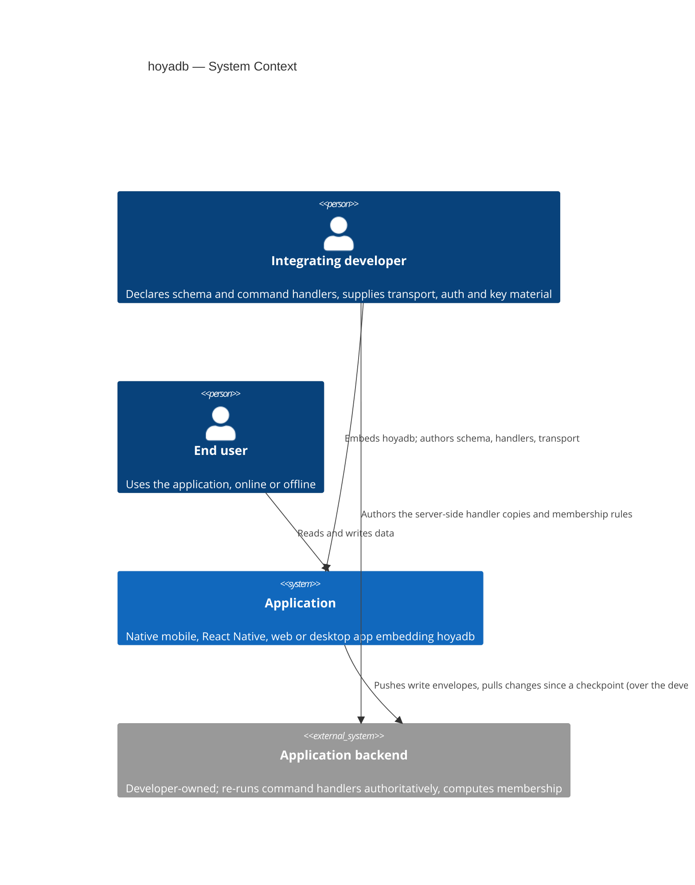
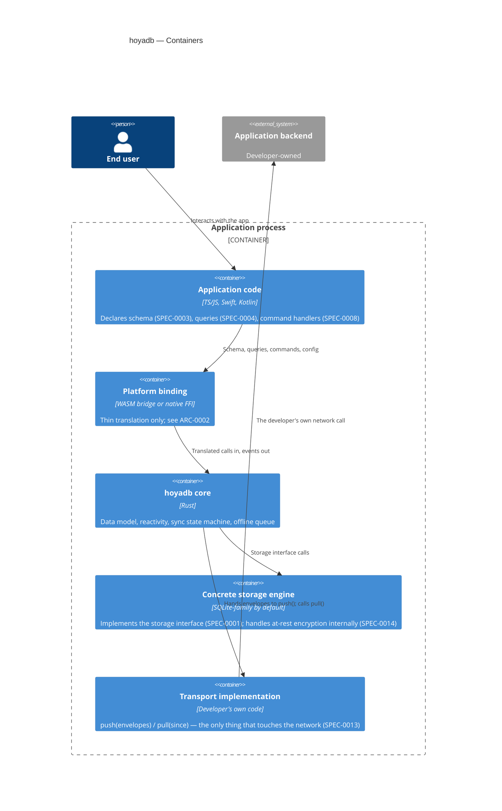

# ARC-0001: hoyadb — system architecture

Trimmed arc42 structure; sections not applicable to a library with no
deployed runtime of its own are omitted. Source:
`legacy/docs/02-architecture/overview.md`.

## 1. Introduction and goals

hoyadb is an offline-first, relational, reactive embedded database **library**.
An application declares a schema with real relationships, reads and writes it
locally with no network required, subscribes to query results that update
live, and reconciles with its own backend through a sync layer whose primary
write unit is a named command.

Quality goals, in priority order:

1. Full local operability with no connectivity (`OBJ-0001`, `NFR-0002`).
2. One behaviourally identical core on every platform (`OBJ-0002`).
3. Backend-authoritative resolution of writes that carry intent (`OBJ-0003`).
4. Query-result-level reactivity rather than a raw change feed (`OBJ-0005`).
5. A boundary hoyadb does not cross: no network, no auth, no telemetry
   (`OBJ-0006`).

## 2. Constraints

- The core is a single Rust implementation, compiled to WASM for the web and
  exposed through native bindings elsewhere (`ADR-0001`). **No precedent for
  this shape exists in this project's own research** — `RISK-0001`.
- Persistence sits behind one narrow, engine-agnostic interface; the concrete
  engine differs per platform, SQLite-family by default (`ADR-0003`).
- hoyadb owns its schema; it is not generated from or matched to an external
  database (`ADR-0002`).
- hoyadb never opens a network connection (`REQ-0028`); the integrating
  developer supplies the transport.
- One authoritative backend is assumed; no peer-to-peer topology
  (`ADR-0006`).

## 3. Context and scope

In scope: the local database, reactive queries, the sync contract, the
offline queue, at-rest protection of the local store.

Out of scope, deliberately: authentication, the network call itself,
transport security, command determinism between the two handler runs, and a
peer-to-peer topology — see `OBJ-0006`, `ADR-0014`, `ADR-0019`.

## 4. Building block view

Container responsibilities:

- **hoyadb core** — the entire data model (`SPEC-0003`, `SPEC-0004`,
  `SPEC-0005`), reactivity's incremental query diffing (`SPEC-0006`,
  `SPEC-0007`), storage-interface dispatch (`SPEC-0001`), and the sync state
  machine (`SPEC-0008` … `SPEC-0012`, `SPEC-0015`). One implementation,
  unchanged by which platform hosts it (`OBJ-0002`). The internal storage
  boundary is API-0002 plus API-0003: core declares and validates supplied
  schema/query models; it does not fetch all rows to execute an engine query.
- **Platform binding** — translates calls in and events out. Reimplements
  nothing; see `ARC-0002`.
- **Concrete storage engine** — durable storage, query execution against its
  own native representation, and at-rest encryption via its own capability
  (`SPEC-0002`, `SPEC-0014`). Swappable per platform without changing
  anything above the interface. API-0003 adds engine-executed typed filtering,
  direct to-one lookup, ordering/limit and owned committed-change results.
  ADR-0030 assigns physical index ownership here. This component does not own
  public schema lifecycle, subscription scheduling or sync reconciliation.
- **Transport implementation** — the developer's own code. **The only
  component in this diagram that touches the network**, which is the
  structural reason `THR-0005` is out of hoyadb's reach.

## 5. Runtime view

**Command write** (`REQ-0010`, `REQ-0011`, `legacy/docs/10-walkthrough.md` steps
3–6): app calls `execute()` → core runs the client handler, serialized,
against a tracked object → the handler's writes commit as one atomic local
transaction → subscriptions re-emit → the envelope is persisted `queued`
(`SPEC-0009`) → when eligible, core hands an array of envelopes to the
developer's `push()` (`SPEC-0013`) → backend re-runs its own handler copy
authoritatively → per-write outcomes return, correlated by idempotency key →
core maps each to a `CommandOutcome` and, on `applied`/`corrected`, swaps the
local id for the backend-assigned one, unblocking dependents (`REQ-0019`).

**Entity-diff write** (`REQ-0023`): an ordinary table mutation generates a
partial-patch payload, queued through the same queue, resolved backend-side
by authorization plus per-field last-write-wins (`SPEC-0011`).

**Pull** (`REQ-0026`): core calls `pull(since)`; the backend computes
membership from the re-derived identity and returns changes plus a new
opaque checkpoint.

## 6. Deployment view

hoyadb has **no deployment of its own** — it is a library embedded in the
application process. The only deployed component in the picture is the
developer's backend, which hoyadb neither ships nor runs. This is why
several threats (`THR-0005`, `THR-0008`) and several decisions (`ADR-0014`,
`ADR-0017`, `ADR-0019`) resolve to "documented requirement on the
integrator" rather than "enforced control."

## 7. Risks and technical debt

- **`RISK-0001`** — the core's Rust-to-WASM/native shape has no precedent in
  this project's research. Validation spike scheduled as the first step of
  `ADR-0008`'s roadmap. Blast radius is this document.
- **`RISK-0002`** — command determinism is transferred to the integrator,
  not solved (`ADR-0014`), with no handler-drift testing story.
- **`RISK-0003`** — concurrent access to one local store from two tabs or
  windows is unaddressed: no file locking, no leader election, no cross-tab
  reactivity. Routine on web and desktop, the platforms this targets.
- **`RISK-0004`** — ADR-0030 resolves physical index ownership; measured query
  costs (TC-0025) and incremental reactive diffing remain validation gates.
- **`RISK-0005`** — bootstrap / initial sync is unspecified; every first run
  hits it.
- **Threats against this architecture**: `THR-0001` … `THR-0008`, of which
  `THR-0004` and `THR-0005` are carried at `accepted-risk` by deliberate
  decision.
- **`NFR-0001` and `NFR-0004` carry no numeric targets**, by decision
  (`ADR-0022`, `ADR-0024`) — this architecture is not yet measured against
  any performance or footprint bound.

## Traceability

- Parents: `OBJ-0001`, `OBJ-0002`, `OBJ-0003`, `OBJ-0005`, `OBJ-0006`,
  `ADR-0001` … `ADR-0006`.
- Satisfies: `NFR-0002`, `NFR-0005`.
- Elaborated by: `ARC-0002`, and the `SPEC-*` component designs.

## Phase 2 concrete data-model boundary — 2026-10-22

API-0004/SPEC-0026 add the public Rust schema, lazy query/relation and authored
migration lifecycle inside the existing core. API-0004's additive SchemaStorage
capability provides catalog inspection, lifecycle-only scans and an atomic schema
plan; ordinary filtering/order/limit remain in API-0003 engines. ADR-0031 records
the approved explicit-through and supported queue-free lifecycle policies.
This extends the existing components; it adds no service/runtime/platform SDK.

## Phase 3 reactive boundary — 2026-10-22

SPEC-0027/API-0005 add a ReactiveDatabase owner and shared projected-key cache
over API-0004. Engines own projected query execution; core owns incremental
net-commit invalidation, modes, pending snapshots and count throttle. Host
bridges drain owned events without holding core borrows across callbacks.
No sync, background runtime, persistent observer state or cross-client delivery.
TC-0029 verifies those boundaries and lifecycle failures.

## Phase 5 entity/pull/reset boundary — 2026-10-24

SPEC-0031/API-0009 extend the existing command owner and atomic SyncStorage,
with one discriminated durable queue, guarded field metadata and validated pure
merge hooks. Owned pull tickets carry scope/checkpoint/generation/revision;
page data, comparison state and progress commit together. ADR-0033 resolves the
original RISK-0005 bootstrap decision with bounded visible pages and explicit
readiness. Reset validates complete application inventory in the transaction,
preserves live recovery by default and retires runtime generations after success.
The foreign hosts still own networking, timers and callbacks; membership and
server tie authority remain external. No new service, dependency or platform SDK
is introduced. The original runtime/gap descriptions above are historical where
this additive contract supplies a concrete mechanism.
