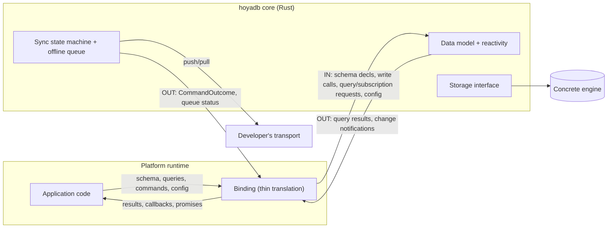

# ARC-0002: hoyadb — core/platform boundary and per-platform bindings

What crosses the core/platform boundary, what never leaves the core, and the
resulting per-platform surface.

## 1. Purpose

`ARC-0001` fixes the layering. This document fixes the **boundary**: the one
seam where `ADR-0001`'s single Rust core meets each platform's own runtime.
Getting this wrong is what would reintroduce the per-platform drift
`OBJ-0002` exists to prevent.

## 2. What never leaves the core

The entire data model (`SPEC-0003`, `SPEC-0004`, `SPEC-0005`), the storage
interface and its concrete engine dispatch (`SPEC-0001`), reactivity's
incremental query diffing (`SPEC-0006`, `SPEC-0007`), and the sync state
machine — offline queue, idempotency tracking, id-mapping for dependent
writes (`SPEC-0008`, `SPEC-0009`, `SPEC-0015`) — all live inside the Rust
core, unchanged by which platform hosts it.

**A platform binding never reimplements any of this.** It translates calls in
and events out, and nothing more. That is the whole content of `OBJ-0002`'s
"count of independent implementations = 1" target metric.

## 3. What crosses the boundary

- **In**: schema declarations; command and entity-diff write calls;
  query and subscription requests; configuration — the trusted-context
  extension point (`REQ-0015`), encryption key material (`REQ-0030`), and
  the `transport` implementation the core calls into (`REQ-0028`).
- **Out**: query and subscription results with their change notifications
  (`REQ-0007`, `REQ-0008`); command outcomes (`REQ-0016`); offline-queue
  status (`REQ-0021`).

No domain logic, no sync state and no storage access cross in the other
direction.

## 4. Per-platform surface

| Target | Mechanism | Surface |
| --- | --- | --- |
| Web | Rust core compiled to WebAssembly, JS/TS wrapper package | `openDatabase`, `defineSchema`, `db.query(...).observe(...)`, `defineCommand` |
| React Native | Native binding (WASM is not the natural mobile runtime) | The same API shape as web |
| Native iOS / Android | Idiomatic Swift / Kotlin wrapper over the same core | Same concepts, per-language naming and async idioms |
| Desktop | Follows web (Electron-style, Node + Chromium) or native (Tauri-style host process) depending on the shell | Matches whichever path the shell uses |

Every wrapper exposes the same concepts — schema, query/subscription,
command, queue status — with the same semantics. Only naming conventions and
async idioms differ.

## 5. Binding requirements and risks

`API-0011` specifies the concrete SDK boundary. Reactive callbacks carry owned
values and run on the host's scheduling policy. `ADR-0025` fixes serialized
handler execution and atomic local commit; cross-language completion must obey
the SDK lifecycle contract. A wrapper must not reproduce shared core semantics.

Concurrent access to one store from separate tabs/processes remains constrained
by the storage adapter's ownership contract (`RISK-0003`). A single-worker test
does not establish cross-tab leadership or cross-process reactivity.

## Implementation contract

The SQLite browser adapter runs in one dedicated worker with asynchronous OPFS
setup and synchronous ready-future operations. Test messages carry owned values;
the experimental bridge grants no cross-thread transfer or consumer-package
support beyond its explicit contract.

## Traceability

- Parents: `OBJ-0002`, `ADR-0001`, `ADR-0025`.
- Satisfies: `NFR-0005`.
- Depends on: `ARC-0001`.
- Risks: `RISK-0001`, `RISK-0003`.

## reactivity reactive boundary contract

Reactive events carry owned rows, counts and typed errors. Extract events before
calling foreign code and check liveness for every callback; hold no Rust borrow
or registry lock across host code. The host owns drain cadence and UI scheduling;
the 16 ms count deadline remains core state. Subscription state is ephemeral,
and replacement workers/processes require independent generation identity.
