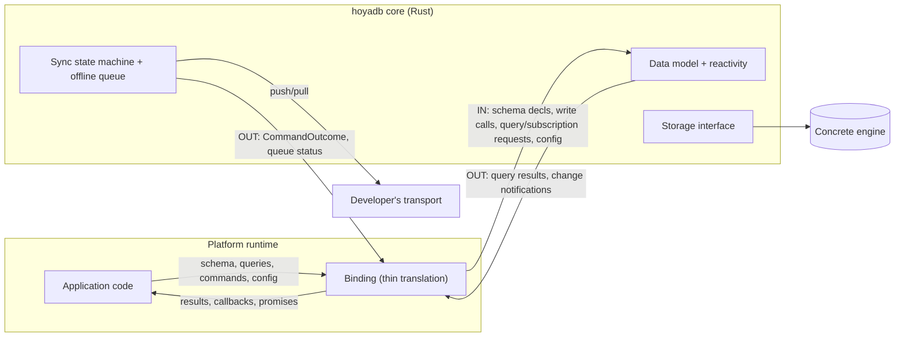

# ARC-0002: hoyadb — core/platform boundary and per-platform bindings

What crosses the core/platform boundary, what never leaves the core, and the
resulting per-platform surface. Source:
`legacy/docs/02-architecture/platform-bindings.md`.

## 1. Purpose

`ARC-0001` fixes the layering. This document fixes the **boundary**: the one
seam where `ADR-0001`'s single Rust core meets each platform's own runtime.
Getting this wrong is what would reintroduce the per-platform drift
`OBJ-0002` exists to prevent.

## 2. What never leaves the core

The entire data model (`SPEC-0003`, `SPEC-0004`, `SPEC-0005`), the storage
interface and its concrete engine dispatch (`SPEC-0001`), reactivity's
incremental query diffing (`SPEC-0006`, `SPEC-0007`), and the sync state
machine — offline queue, idempotency tracking, id-mapping for dependent
writes (`SPEC-0008`, `SPEC-0009`, `SPEC-0015`) — all live inside the Rust
core, unchanged by which platform hosts it.

**A platform binding never reimplements any of this.** It translates calls in
and events out, and nothing more. That is the whole content of `OBJ-0002`'s
"count of independent implementations = 1" target metric.

## 3. What crosses the boundary

- **In**: schema declarations; command and entity-diff write calls;
  query and subscription requests; configuration — the trusted-context
  extension point (`REQ-0015`), encryption key material (`REQ-0030`), and
  the `transport` implementation the core calls into (`REQ-0028`).
- **Out**: query and subscription results with their change notifications
  (`REQ-0007`, `REQ-0008`); command outcomes (`REQ-0016`); offline-queue
  status (`REQ-0021`).

No domain logic, no sync state and no storage access cross in the other
direction.

## 4. Per-platform surface

| Target | Mechanism | Surface |
| --- | --- | --- |
| Web | Rust core compiled to WebAssembly, JS/TS wrapper package | `openDatabase`, `defineSchema`, `db.query(...).observe(...)`, `defineCommand` |
| React Native | Native binding (WASM is not the natural mobile runtime) | The same API shape as web |
| Native iOS / Android | Idiomatic Swift / Kotlin wrapper over the same core | Same concepts, per-language naming and async idioms |
| Desktop | Follows web (Electron-style, Node + Chromium) or native (Tauri-style host process) depending on the shell | Matches whichever path the shell uses |

Every wrapper exposes the same concepts — schema, query/subscription,
command, queue status — with the same semantics. Only naming conventions and
async idioms differ.

## 5. Open questions and risks

This is the section `legacy/docs/02-architecture/platform-bindings.md` is most
explicit about, and none of it is resolved here:

- **Reactivity across the boundary is the hardest open design question this
  split raises.** How live subscription notifications propagate from
  Rust-core state across FFI/WASM into a platform's own UI reactivity system
  (e.g. React's render cycle) efficiently is **unresolved**. Named in
  `legacy/PLAN_DECISIONS.md` D0; tracked as part of `RISK-0001`.
- **The handler-callback mechanism is only partly settled.** `ADR-0025`
  fixes the ordering and atomicity contract — the core calls into a handler
  at most one at a time, and the handler may call back asynchronously for
  reads and writes before the core commits. The **concrete FFI/WASM
  mechanics of that async cross-language callback are still unresolved**.
- **The concrete FFI mechanism per native platform** (raw C ABI, UniFFI, or
  another binding generator) is implementation-time detail, not fixed here.
- **The React Native binding candidate is unconfirmed.**
  `legacy/PLAN_DECISIONS.md` D0 names craby.rs as a candidate needing checking;
  `ADR-0001` does not adopt it. It is to be evaluated during `ADR-0008`'s
  validation spike.
- **`RISK-0003` — concurrent access to one local store from two tabs or
  windows is unaddressed**: no file locking, no leader election for which
  instance drives sync, no cross-tab or cross-window reactivity propagation.
  Routine on exactly the platforms this document targets.

This document fixes the layering and per-platform surface shape. It does not
fix the binding toolchain, and it does not close any of the above.

## Implementation checkpoint — 2026-10-22

SPEC-0023 now exercises the production Rust SQLite adapter inside one dedicated
browser worker, with asynchronous OPFS setup and synchronous ready-future CRUD/
batches. A test-only message bridge moves owned values; it adds no production
consumer package or thread-transfer guarantee. Exact worker/page restart results
and the remaining platform limitations are recorded in
[the implementation report](../../implementation/browser-persistence.md).
Native bindings and command/reactivity ownership remain separate Stage 0
experiments; no accepted ADR is changed by this checkpoint.

## Traceability

- Parents: `OBJ-0002`, `ADR-0001`, `ADR-0025`.
- Satisfies: `NFR-0005`.
- Depends on: `ARC-0001`.
- Risks: `RISK-0001`, `RISK-0003`.

## Phase 3 reactive boundary checkpoint — 2026-10-23

SPEC-0027/API-0005 now use the production ReactiveDatabase core with owned row,
count and typed-error events. A dedicated SQLite/OPFS worker sends owned events
to a main-thread wrapper, while the fixed Swift desktop fixture uses production
core/memory through a checked C ABI. Both drain after extraction, checking
liveness for every callback; no Rust borrow or registry lock spans host code.
The host owns drain cadence and UI scheduling; the 16 ms count deadline is core
state. Subscription state is ephemeral and process/worker replacement adds
bridge generation identity. These are experimental test bridges; packaged SDKs,
mobile tools, concurrency and bootstrap semantics remain unresolved. See
[Phase 3 execution evidence](../../implementation/phase-three-reactivity.md).
